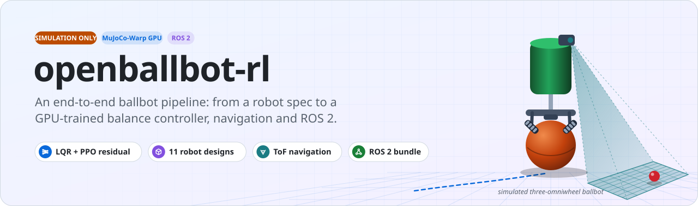
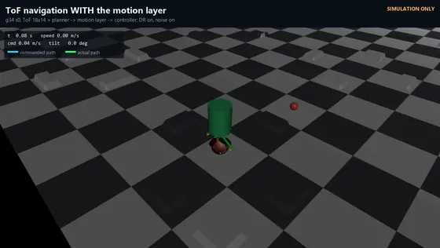
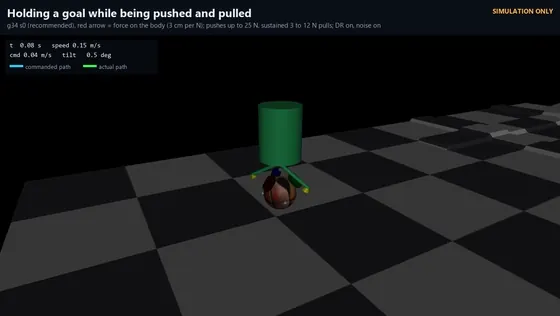
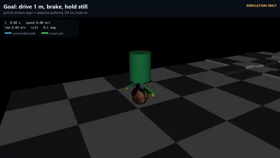
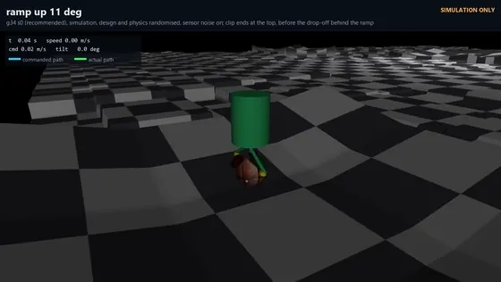
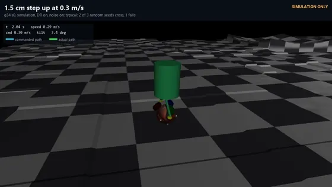
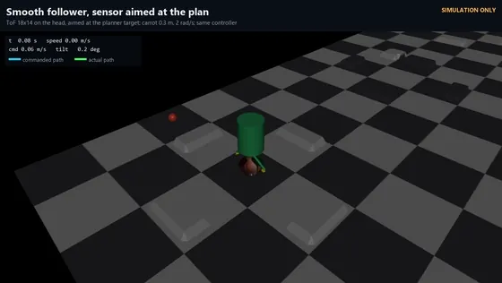
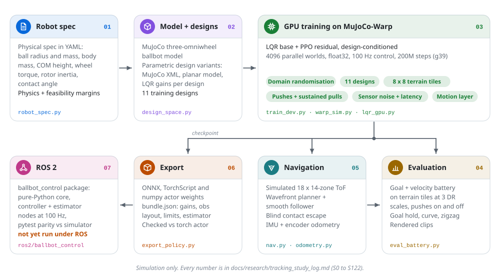
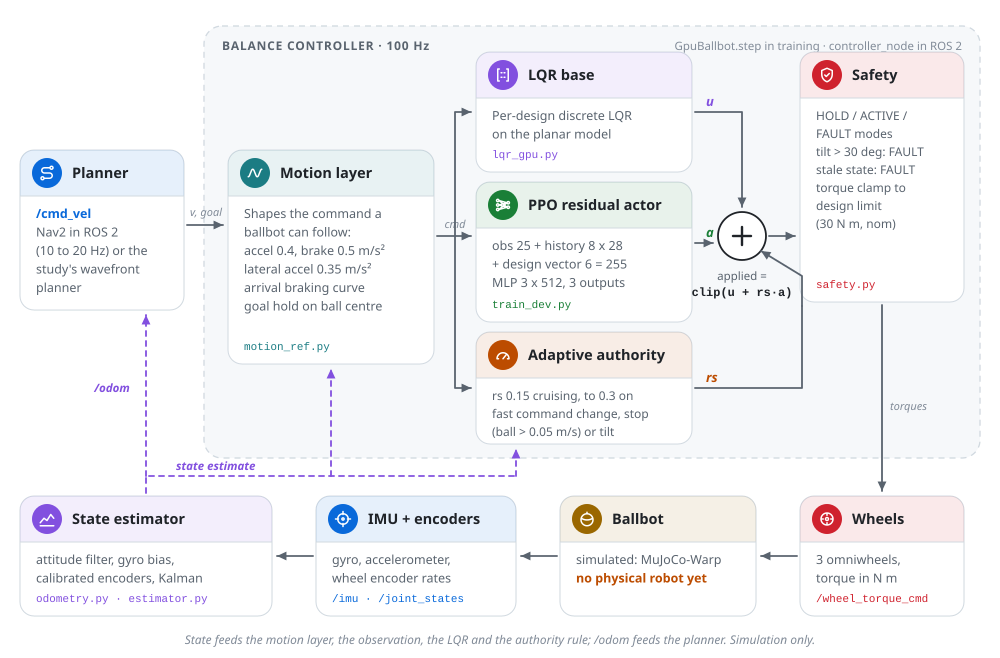
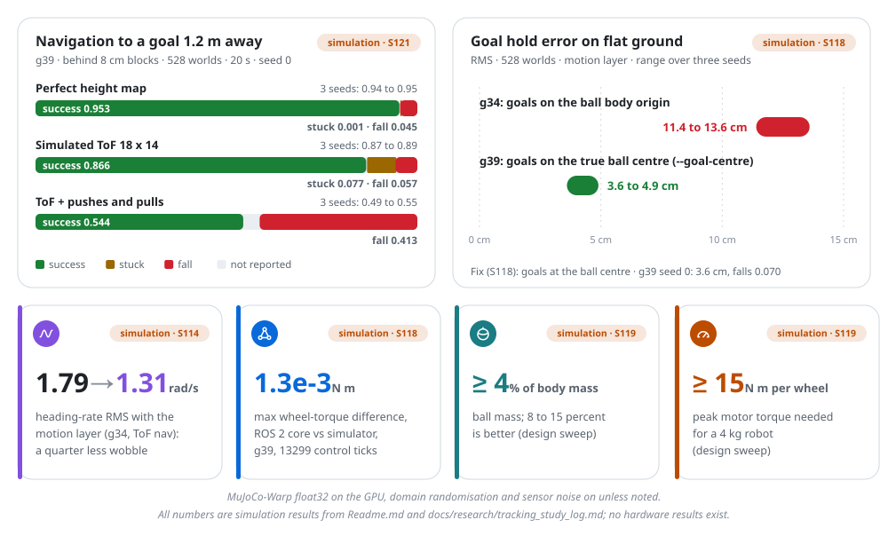

<p align="center">
  <picture>
    <source media="(prefers-color-scheme: dark)" srcset="docs/assets/hero-dark.svg">
    
  </picture>
</p>

<p align="center">
  <a href="LICENSE"></a>
  
  
  <a href="ros2/README.md"></a>
  
  <a href="https://n3b3x.github.io/openballbot-rl/"></a>
</p>

<p align="center">
  <a href="https://n3b3x.github.io/openballbot-rl/"><b>Website</b></a> &middot;
  <a href="https://n3b3x.github.io/openballbot-rl/videos.html"><b>Videos</b></a> &middot;
  <a href="https://n3b3x.github.io/openballbot-rl/learn/index.html"><b>Course</b></a> &middot;
  <a href="docs/pipeline.md"><b>Pipeline walkthrough</b></a> &middot;
  <a href="docs/research/tracking_study_log.md"><b>Study log</b></a> &middot;
  <a href="docs/research/design_guidelines.md"><b>Design guidelines</b></a> &middot;
  <a href="ros2/README.md"><b>ROS 2 package</b></a> &middot;
  <a href="docs/README.md"><b>Docs index</b></a>
</p>

# openballbot-rl: an end-to-end ballbot pipeline, from robot spec to ROS 2 (simulation only)

A small three-omniwheel ballbot, taken from a physical spec to a simulated robot, a GPU-trained balance controller
(LQR base plus a learned PPO residual), depth-sensor navigation, state estimation and an exported ROS 2 controller
package. Every result in this repository is from simulation. There is no physical robot yet.

Headline results, all simulated (details and settings in [Current results](#current-results)):

- A goal 1.2 m away behind 8 cm blocks is reached in 0.87 of runs with a simulated 18 x 14-zone ToF depth sensor
  (0.95 with a perfect height map), across 11 robot designs with randomised physics (S121).
- The robot holds a goal to within 3.6 to 4.9 cm RMS on flat ground, against 11 to 14 cm before the goal-logic fix (S118, S121).
- Sustained pulls are the main open problem: with 3 to 12 N pulls, 0.361 of g34 robots fall (S116); pulls up to about 3 N are absorbed.
- The exported ROS 2 controller core reproduces the simulator's wheel torques to 1.3e-3 N m in a pytest parity test.
  The package has not been run under ROS.

| Resource | Where |
|---|---|
| Website | https://n3b3x.github.io/openballbot-rl/ (source in [site/](site/)) |
| Course: the ballbot, LQR, learning, navigation and ROS 2 step by step | https://n3b3x.github.io/openballbot-rl/learn/index.html (source in [site/learn/](site/learn/)) |
| Study log, the source of truth for every number | [docs/research/tracking_study_log.md](docs/research/tracking_study_log.md) (entries S0 to S122) |
| Pipeline walkthrough with commands and flags | [docs/pipeline.md](docs/pipeline.md) |
| Design guidelines for building the robot | [docs/research/design_guidelines.md](docs/research/design_guidelines.md) |
| ROS 2 package | [ros2/README.md](ros2/README.md) |
| Documentation index | [docs/README.md](docs/README.md) |

The repository started as a fork of Achkan Salehi's code for "Reinforcement Learning for Ballbot Navigation in Uneven
Terrain" (arXiv:2505.18417, Apache-2.0); see [Origins and credit](#origins-and-credit).

## In simulation

Short previews of single simulated runs (MuJoCo-Warp physics, MuJoCo renderer). Click a preview for the full clip with
its setup and what to watch for. The clips show the earlier controllers g34 and g18; the recommended controller is g39
(S121). One run is an anecdote: the rates are in [Current results](#current-results).

<table>
  <tr>
    <td width="33%" valign="top">
      <a href="https://n3b3x.github.io/openballbot-rl/videos.html#c12_nav_with_layer"></a>
      <br><sub><b>ToF navigation through the motion layer.</b> Goal 1.2 m away behind 8 cm blocks, simulated 18 x 14-zone ToF; g34, raised-COM design. 2x speed.</sub>
    </td>
    <td width="33%" valign="top">
      <a href="https://n3b3x.github.io/openballbot-rl/videos.html#c13_push_pull_hold"></a>
      <br><sub><b>Holding a goal while pushed and pulled.</b> The red arrow is the applied force; g34, nominal design. 2x speed.</sub>
    </td>
    <td width="33%" valign="top">
      <a href="https://n3b3x.github.io/openballbot-rl/videos.html#c11_goal_hold_nom"></a>
      <br><sub><b>Drive 1 m, brake, hold still.</b> The motion layer brakes on a profile into the goal and holds; g34. 2x speed.</sub>
    </td>
  </tr>
  <tr>
    <td width="33%" valign="top">
      <a href="https://n3b3x.github.io/openballbot-rl/videos.html#c11_ramp_zhigh"></a>
      <br><sub><b>0.6 m/s up an 11 degree ramp.</b> Raised-COM design, g34; the clip ends at the top. Real time.</sub>
    </td>
    <td width="33%" valign="top">
      <a href="https://n3b3x.github.io/openballbot-rl/videos.html#c11_step15_nom"></a>
      <br><sub><b>A 1.5 cm step at 0.3 m/s.</b> Slows and leans at the riser, then crosses; g34. Of three seeds rendered, two crossed. Real time.</sub>
    </td>
    <td width="33%" valign="top">
      <a href="https://n3b3x.github.io/openballbot-rl/videos.html#c8_nav_tof18_smooth"></a>
      <br><sub><b>Smooth follower, sensor aimed at the plan.</b> The earlier controller g18 with the 18 x 14 ToF on the head. 2x speed.</sub>
    </td>
  </tr>
</table>

More clips, including failures, are on the [videos page](https://n3b3x.github.io/openballbot-rl/videos.html).
The previews are made by [scripts/docs/make_previews.py](scripts/docs/make_previews.py).

## Pipeline

<picture>
  <source media="(prefers-color-scheme: dark)" srcset="docs/assets/pipeline-dark.svg">
  
</picture>

| Stage | What it does | Key files |
|---|---|---|
| Robot spec | Physical spec (ball radius and mass, body mass and COM height, motor torque, rotor inertia, contact angle) to a simulated design, with analytic physics margins and an optional simulated evaluation | [scripts/study/robot_spec.py](scripts/study/robot_spec.py), [specs/](specs/), [scripts/study/design_space.py](scripts/study/design_space.py), [scripts/study/design_constraints.py](scripts/study/design_constraints.py) |
| Model | MuJoCo model of the three-omniwheel ballbot and its design variants | [ballbot_gym/models/ballbot.xml](ballbot_gym/models/ballbot.xml), [ballbot_gym/models/variants/](ballbot_gym/models/variants/) |
| Simulation | GPU-parallel MuJoCo-Warp (float32), omniwheel contact-frame fix, 8 x 8 tiled terrain map, domain randomisation, floor surfaces, pushes and sustained pulls, sensor noise and latency | [experiments/mjx_port/warp_sim.py](experiments/mjx_port/warp_sim.py), [experiments/warp_ppo/tiles.py](experiments/warp_ppo/tiles.py), [experiments/warp_ppo/train_dev.py](experiments/warp_ppo/train_dev.py) |
| Controller | Per-design LQR base plus a PPO residual with adaptive authority and a goal dead band, design-conditioned over 11 designs; a motion-reference layer between planner and controller | [experiments/warp_ppo/train_dev.py](experiments/warp_ppo/train_dev.py), [experiments/warp_ppo/lqr_gpu.py](experiments/warp_ppo/lqr_gpu.py), [experiments/warp_ppo/motion_ref.py](experiments/warp_ppo/motion_ref.py) |
| Evaluation | Standard battery (goal and velocity tasks on terrain tiles at three DR scales, with and without disturbances), motion tests, renders | [experiments/warp_ppo/eval_battery.py](experiments/warp_ppo/eval_battery.py), [eval_tiles2.py](experiments/warp_ppo/eval_tiles2.py), [eval_motion.py](experiments/warp_ppo/eval_motion.py), [render_policy.py](experiments/warp_ppo/render_policy.py) |
| Navigation | Simulated multizone ToF depth sensor, wavefront planner with a smooth follower, blind contact escape, IMU and wheel-encoder odometry | [eval_nav.py](experiments/warp_ppo/eval_nav.py), [nav.py](experiments/warp_ppo/nav.py), [escape.py](experiments/warp_ppo/escape.py), [odometry.py](experiments/warp_ppo/odometry.py), [eval_odom.py](experiments/warp_ppo/eval_odom.py) |
| Deployment | Checkpoint export (ONNX, TorchScript, numpy weights, JSON bundle) and a ROS 2 package with a pure-Python core and parity tests against the simulator | [experiments/warp_ppo/export_policy.py](experiments/warp_ppo/export_policy.py), [ros2/ballbot_control/](ros2/ballbot_control/) |
| Outputs | Research website and paper draft | [site/](site/), [paper_v2/](paper_v2/) |

## How the controller works

<picture>
  <source media="(prefers-color-scheme: dark)" srcset="docs/assets/controller-dark.svg">
  
</picture>

A planner sends a velocity (or a goal). The motion-reference layer turns it into a command a ballbot can follow, the
per-design LQR base and the learned residual both act on it, and the adaptive authority sets how much of the residual is
applied. Safety checks and the design's torque limit come last. The same loop runs in training
([train_dev.py](experiments/warp_ppo/train_dev.py), [motion_ref.py](experiments/warp_ppo/motion_ref.py)) and in the
ROS 2 core ([ros2/README.md](ros2/README.md)), where a state estimator from IMU and wheel encoders replaces the simulator
state.

## Current results

<picture>
  <source media="(prefers-color-scheme: dark)" srcset="docs/assets/results-dark.svg">
  
</picture>

Recommended controller: `g39_goalcentre_s0` (S121). It is the S113 recipe (LQR base plus PPO residual, adaptive
authority 0.15 / 0.3 with a 0.05 m/s dead band, 80 ms observation history, 11 designs, motion-reference layer, 200M
steps) with all goal logic on the true ball centre. S118 found that earlier runs measured goals at the ball body origin,
which sits 0.14 m from the ball centre and swings around it as the ball rolls; `--goal-centre` fixes this.

Unless a row says otherwise: MuJoCo-Warp float32 on the GPU, domain randomisation on, sensor noise on. Simulation only.

| Test | Result | Setting | Log |
|---|---|---|---|
| Navigation to a goal 1.2 m away behind 8 cm blocks, simulated 18 x 14-zone ToF, wavefront planner, motion layer | success 0.866, stuck 0.077, fall 0.057 (s0); success 0.87 to 0.89 over three seeds | 528 worlds (11 designs x 48), 20 s, no disturbances | S121 |
| Same, with pushes and sustained pulls | success 0.544, fall 0.413 (s0); success 0.49 to 0.55 over three seeds | as above, pushes and pulls on | S121 |
| Same, perfect height map instead of the ToF | success 0.953, stuck 0.001, fall 0.045 (s0); 0.94 to 0.95 over three seeds | as above | S121 |
| Goal hold on flat ground | hold error 3.6 cm RMS, falls 0.070 (s0); 3.6 to 4.9 cm over three seeds, against 11.4 to 13.6 cm for g34 (goals on the ball body origin) | eval_motion.py goal test, 528 worlds, motion layer | S118 |
| Goal battery on terrain tiles | goal success 0.75 undisturbed and 0.49 with pushes and pulls at standard DR; 0.70 and 0.37 at 2.5 x DR | eval_battery.py, 16 worlds per design and terrain kind | S118, S121 |
| Disturbances (g34, the same recipe before the goal-centre fix) | short pushes absorbed; sustained pulls absorbed up to about 3 N; at 3 to 12 N, 0.361 of robots fall | flat map, 352 worlds | S116 |
| Motion-reference layer (g34) | heading-rate RMS 1.79 to 1.31 rad/s (a quarter less wobble), about 0.3 s slower per route | ToF navigation as above | S114 |
| Blind contact escape, no terrain sensing (g26) | goals reached 0.54 with escape at 0.3 m/s (falls 0.35), against 0.09 driving straight at the goal (falls 0.91) | blocks map, 528 worlds, 20 s | S109 |
| Odometry from IMU and 4096-count wheel encoders, calibrated (g26) | position error 0.05 m after 10 s, 0.22 m after 60 s (about 2 percent of distance on flat ground); 3.6 to 3.8 percent on terrain | nominal design, 64 test robots | S108 |
| ROS 2 core against the simulator (g39 bundle) | max wheel-torque difference 1.3e-3 N m over 13299 control ticks (S118 recorded 1.5e-3 over 14155 ticks for the g34 bundle) | 33 worlds, all 11 designs, DR and pushes on, noise and latency off | [ros2/README.md](ros2/README.md), S118 |

In progress: `g41_gc_dbc` (S122) retrains the g39 recipe with `--db-centre`, so the authority dead band reads the ball-centre
velocity as the ROS 2 core does. Seed 0 is indistinguishable from g39 on every number (goal hold error 4.3 cm, ToF navigation
success 0.860); seeds 1 and 2 are retraining, and the controller bundle stays g39 until three seeds agree.

Design findings (S119, summarised in [docs/research/design_guidelines.md](docs/research/design_guidelines.md)): ball mass
is the strongest single property (at least 4 percent of the body mass, 8 to 15 percent is better), a peak motor torque of
at least 15 N m per wheel is needed for a 4 kg robot, and a higher body centre of mass is easier to balance.

## Quick start

The current pipeline needs an NVIDIA GPU with CUDA. The study ran on Windows with Git Bash, using a virtual environment
at `experiments/mjx_port/.venv` (Python 3.12). There is no lock file for it; the study venv has mujoco 3.17.0,
mujoco-warp 3.17.0, warp-lang 1.19.0, torch 2.11.0+cu128, numpy, scipy, PyYAML, pandas, pillow and imageio-ffmpeg.
A fresh install from these versions has not been tested.

```bash
python -m venv experiments/mjx_port/.venv
source experiments/mjx_port/.venv/Scripts/activate        # Linux: experiments/mjx_port/.venv/bin/activate
pip install torch --index-url https://download.pytorch.org/whl/cu128
pip install mujoco==3.17.0 mujoco-warp==3.17.0 warp-lang==1.19.0 numpy scipy pyyaml pandas pillow imageio-ffmpeg
```

The scripts and queue files call the interpreter as `../mjx_port/.venv/Scripts/python.exe` from `experiments/warp_ppo`
(Windows layout); `robot_spec.py --eval` hardcodes that path. Stock MuJoCo is enough: the omniwheel contact-frame fix is
applied in [warp_sim.py](experiments/mjx_port/warp_sim.py), so the MuJoCo patch of the upstream README is not needed.

Trained checkpoints (`outputs/study/warp_ppo/<run>/model.pt`) are not tracked in git; evaluation result files and the
exported g39 and g34 bundles in `ros2/ballbot_control/config/bundle/` are.

Train the recommended recipe (g39, about 200M steps on 4096 worlds):

```bash
cd experiments/warp_ppo
PY=../mjx_port/.venv/Scripts/python.exe
$PY train_dev.py --name g39_goalcentre_s0 --seed 0 --nworld 4096 --steps 200e6 --goal-p 0.5 --pull \
  --dr-scale 1.75 --dr-ramp 0.5 --lqr-base 0.25 --rw-track 2.0 --cross-focus 0.6 \
  --designs nom,zhigh,zlow,kb4,bal4,J02,tau6,bal025,kb025,zeta41,zeta66 --design-cond \
  --width 512 --layers 3 --hist 8 --asym --surfaces --tiles --retainer 0,0,0,100 \
  --motion-ref --rs-adapt 0.15,0.3,0.05 --goal-centre
```

Evaluate it (each script re-applies the run's training settings from `args.json`):

```bash
$PY eval_motion.py --run g39_goalcentre_s0 --scenario goal --mode ref --out motion_goal_ref
$PY eval_battery.py --run g39_goalcentre_s0 --dr-scales 1.0 1.75 2.5
PUSH_SCALE=0 $PY eval_nav.py --run g39_goalcentre_s0 --source sensor --res 18x14 --fov 55,42 \
  --planner smooth --carrot 0.3 --w-max 2.0 --aim target --out navS_tof18
```

Build and check a robot design from a spec, and run the ROS 2 tests (no ROS and no GPU needed for the tests):

```bash
python scripts/study/robot_spec.py build specs/nominal.yaml           # add --eval for the simulated evaluation (GPU)
cd ros2/ballbot_control && python -m pytest -q
```

[docs/pipeline.md](docs/pipeline.md) has the full set of stages, flags and environment variables.

## Repository map

| Path | Status | Contents |
|---|---|---|
| [experiments/warp_ppo/](experiments/warp_ppo/) | current | GPU training (`train_dev.py`), evaluation, navigation, motion layer, odometry, renders, export. `train.py` is the earlier S21 trainer |
| [experiments/mjx_port/](experiments/mjx_port/) | current (simulator core) | `warp_sim.py` (MuJoCo-Warp wrapper with the contact-frame fix) and `common.py` used by every GPU script; the rest is the engine feasibility study ([REPORT.md](experiments/mjx_port/REPORT.md)) |
| [scripts/study/](scripts/study/) | current and earlier | Design tools (`robot_spec.py`, `design_space.py`, `design_constraints.py`), report and figure scripts; the CPU study tools of S0 to S20 (SB3 PPO on the CPU environment) |
| [specs/](specs/) | current | Robot spec YAML files for `robot_spec.py` |
| [ballbot_gym/](ballbot_gym/) | partly current | MuJoCo model and design variants used by the GPU pipeline; the Gymnasium CPU environment and controllers from the upstream code and the CPU study |
| [ros2/](ros2/) | current | ROS 2 package `ballbot_control` with exported controller bundles and tests |
| [docs/research/](docs/research/) | current | Study log, design guidelines and rules, literature notes, roadmap |
| [site/](site/) | current | Published research website |
| [paper_v2/](paper_v2/) | current | Paper draft: derived dynamics and learned control, with a section on the generalist controller |
| [outputs/study/](outputs/study/) | current | Evaluation results per run (checkpoints are git-ignored) |
| [ballbot_rl/](ballbot_rl/), [configs/](configs/), [examples/](examples/) | legacy | Upstream SB3 training path (depth encoder, YAML configs, CLI entry points) |
| [paper/](paper/), [notebooks/](notebooks/), [submission/](submission/) | legacy | Earlier perception-guided course-project study on the CPU path |
| [experiments/isaac_port/](experiments/isaac_port/), [experiments/ring_wheel/](experiments/ring_wheel/) | side studies | Isaac Sim / PhysX port and roller-ring wheel checks (S20, S22) |
| [tools/](tools/), [scripts/setup/](scripts/setup/) | legacy | Upstream MuJoCo patch and installers, plotting tools |

## Status and limitations

- Simulation only. No physical robot exists; no number here is a hardware result. Nothing here has been run on hardware.
- The GPU engine is float32 MuJoCo-Warp. Its per-trajectory error against the CPU engine is 25 to 100 times the CPU
  version-to-version spread ([experiments/mjx_port/REPORT.md](experiments/mjx_port/REPORT.md)); GPU runs are not bit-reproducible.
- The ROS 2 package was never built or run under ROS and never on hardware; it is tested with pytest against recorded
  simulator data ([ros2/README.md](ros2/README.md), "What was not verified").
- Sustained pulls above about 3 N and pushes near obstacles remain the main failure cases (S114, S116, S121).
- The trained policies depend on an observation quirk of the training environment (entries 9 to 11 are base velocities
  and a body rate, not wheel rates, S118 note); the deployment core reproduces it.
- The controller was trained on 11 designs around the nominal robot; `robot_spec.py --eval` on designs far outside that set
  is extrapolation (S119).
- Odometry drifts in heading (11.8 degrees median after 60 s with a simulated MEMS gyro, S108); longer missions need an absolute reference.

## Origins and credit

This repository began as a fork of the code for:

> Achkan Salehi. "Reinforcement Learning for Ballbot Navigation in Uneven Terrain." arXiv:2505.18417, 2025.
> https://arxiv.org/abs/2505.18417 (upstream repository: https://github.com/salehiac/OpenBallBot-RL)

The upstream work is released under the Apache License 2.0, and so is this repository; the license file is unchanged.
The git history keeps Salehi's original commits (126 of the 158 commits, January to May 2025), so authorship of the
upstream code is recorded in `git log`.

From upstream: the MuJoCo ballbot model and meshes (`bbot.xml`), the Gymnasium environment (`bbot_env.py`), the reward
and terrain code, the SB3 PPO training script with a pretrained depth encoder, the MuJoCo patch and the example training
config. In December 2025 these files were reorganised into the packages [ballbot_gym/](ballbot_gym/) and
[ballbot_rl/](ballbot_rl/) with a component registry, YAML configs ([configs/](configs/)), sensors, tests and documentation
(for example `bbot.xml` became [ballbot_gym/models/ballbot.xml](ballbot_gym/models/ballbot.xml)). That CPU path is kept as
the legacy path.

New in this repository: the GPU pipeline on MuJoCo-Warp with the omniwheel contact-frame fix, the LQR base plus PPO residual
controller and the 11-design generalist, the motion-reference layer, ToF navigation and blind contact escape, IMU and
wheel-encoder odometry, the robot-spec and design-space tools with the design guidelines, the ROS 2 package with exported
bundles and parity tests, the study log, the website and course, and the paper draft. The upstream paper does not
cover these; their results should not be attributed to it.

If you use the simulator or the upstream method, please cite:

```bibtex
@misc{salehi2025reinforcementlearningballbotnavigation,
      title={Reinforcement Learning for Ballbot Navigation in Uneven Terrain},
      author={Achkan Salehi},
      year={2025},
      eprint={2505.18417},
      archivePrefix={arXiv},
      primaryClass={cs.RO},
      url={https://arxiv.org/abs/2505.18417},
}
```

## License

Apache License 2.0, see [LICENSE](LICENSE). The upstream code is under the same license. To cite this repository, see [CITATION.cff](CITATION.cff).
