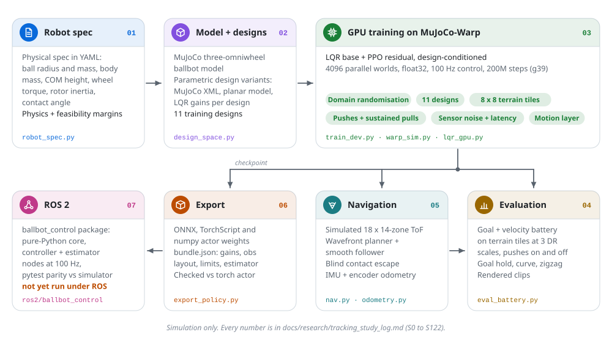

# Documentation

Index for the current pipeline: robot spec, MuJoCo-Warp simulation, GPU training of an LQR plus PPO-residual controller,
evaluation, navigation, state estimation and ROS 2 export. Everything is simulation; there is no physical robot.

<picture>
  <source media="(prefers-color-scheme: dark)" srcset="assets/pipeline-dark.svg">
  
</picture>

## Start here

| Read | For |
|---|---|
| [pipeline.md](pipeline.md) | Every stage with its files, commands, flags and environment variables |
| [research/tracking_study_log.md](research/tracking_study_log.md) | The study log (S0 to S122), the source of truth for every number |
| [../Readme.md](../Readme.md) | Project overview, headline results, quick start, repository map |
| Website: https://n3b3x.github.io/openballbot-rl/ | Results, clips and the study narrative (source in [../site/](../site/)) |
| Course: https://n3b3x.github.io/openballbot-rl/learn/index.html | The ballbot, LQR, learning, navigation, odometry, design and ROS 2 step by step (source in [../site/learn/](../site/learn/)) |

Diagrams in [assets/](assets/) come in light and dark variants and are generated by
[../scripts/docs/make_diagrams.py](../scripts/docs/make_diagrams.py); the clip previews by
[../scripts/docs/make_previews.py](../scripts/docs/make_previews.py). Check links and paths in these documents with
`python scripts/docs/check_docs.py`.

## By goal

| Goal | Read | Then run |
|---|---|---|
| Train a controller | [pipeline.md, section 3](pipeline.md#3-training-the-controller); log entries S110 to S122 for the current recipe and why each flag exists | [train_dev.py](../experiments/warp_ppo/train_dev.py) |
| Evaluate a checkpoint | [pipeline.md, section 4](pipeline.md#4-evaluation) (battery, motion tests, environment variables, how `args.json` is re-applied) | [eval_battery.py](../experiments/warp_ppo/eval_battery.py), [eval_motion.py](../experiments/warp_ppo/eval_motion.py), [eval_tiles2.py](../experiments/warp_ppo/eval_tiles2.py) |
| Navigate among obstacles | [pipeline.md, section 5](pipeline.md#5-navigation-and-state-estimation); log S89, S90, S104, S109, S114, S121 (navigation) and S108 (odometry) | [eval_nav.py](../experiments/warp_ppo/eval_nav.py), [nav.py](../experiments/warp_ppo/nav.py), [escape.py](../experiments/warp_ppo/escape.py), [odometry.py](../experiments/warp_ppo/odometry.py) |
| Design a robot | [research/design_guidelines.md](research/design_guidelines.md) (S119), [research/design_rules.md](research/design_rules.md) (analytic constraints), [pipeline.md, section 1](pipeline.md#1-robot-spec-to-simulated-design) | [robot_spec.py](../scripts/study/robot_spec.py) with [specs/nominal.yaml](../specs/nominal.yaml) |
| Deploy with ROS 2 | [../ros2/README.md](../ros2/README.md) (architecture, topics, safety, real-time notes, what was not verified), [pipeline.md, section 6](pipeline.md#6-export-and-ros-2) | [export_policy.py](../experiments/warp_ppo/export_policy.py), `python -m pytest -q` in [../ros2/ballbot_control/](../ros2/ballbot_control/) |
| Reproduce the website and paper numbers | [pipeline.md, section 7](pipeline.md#7-website-and-paper); [research/site_crosscheck.md](research/site_crosscheck.md) (generated cross-check); the site's [reproduce page](../site/reproduce.html) | [../site/build_data.py](../site/build_data.py), [../scripts/study/make_tracking_report.py](../scripts/study/make_tracking_report.py) |
| Understand the simulator engines | [../experiments/mjx_port/REPORT.md](../experiments/mjx_port/REPORT.md) (MuJoCo-Warp fidelity and speed), [../experiments/isaac_port/REPORT.md](../experiments/isaac_port/REPORT.md) (Isaac Sim / PhysX), log S20 to S22 | |

## Research notes (current)

The full index is [research/README.md](research/README.md).

| Document | Contents |
|---|---|
| [research/tracking_study_log.md](research/tracking_study_log.md) | Study log: every experiment, its protocol, result and decision |
| [research/design_guidelines.md](research/design_guidelines.md) | Building guidelines from the S119 design sweep (ball mass, motor torque, COM height, rotor inertia, contact angle) |
| [research/design_rules.md](research/design_rules.md) | Analytic design constraints from the planar model, with simulation and literature checks |
| [research/generalist_program.md](research/generalist_program.md) | Research program for the generalist controller (workstreams and infrastructure status as of 2026-11-05) |
| [research/ballbot_v2_roadmap.md](research/ballbot_v2_roadmap.md) | Roadmap from simulation to a small real robot (earlier; cites the CPU-path paper) |
| [research/site_crosscheck.md](research/site_crosscheck.md) | Generated check of site and paper numbers against the result files |
| [research/lit_ballbot_classical.md](research/lit_ballbot_classical.md), [research/lit_ballbot_learning.md](research/lit_ballbot_learning.md), [research/lit_ballbot_hardware.md](research/lit_ballbot_hardware.md), [research/lit_rl_sota.md](research/lit_rl_sota.md) | Literature surveys |
| [research/papers/](research/papers/) | Reference papers, including the upstream paper (Salehi 2025) |

## Background (still valid, written for the upstream CPU environment)

These explain ballbot physics and reward design. Their code references point to `ballbot_gym` (the CPU Gymnasium
environment), not to the GPU pipeline.

| Document | Contents |
|---|---|
| [concepts/ballbot_mechanics.md](concepts/ballbot_mechanics.md) | Ballbot physics and dynamics |
| [concepts/reward_design.md](concepts/reward_design.md) | Turning control constraints into rewards (the upstream directional reward) |
| [research/mechanics_to_rl.md](research/mechanics_to_rl.md) | From Lagrangian mechanics to the RL formulation |
| [research/timeline.md](research/timeline.md) | Ballbot research history, 2006 to 2025 |
| [research/terrain_types_for_ballbot.md](research/terrain_types_for_ballbot.md) | Terrain types and why they matter |

## Legacy: the upstream SB3 path

These documents describe the code inherited from the upstream repository: the `ballbot_gym` Gymnasium environment with
the component registry, the `ballbot_rl` Stable-Baselines3 PPO training with a pretrained depth encoder, YAML configs in
`configs/` and the `ballbot-train` style CLI entry points. They are kept for reference and are not updated for the
current pipeline.

| Folder or file | Contents |
|---|---|
| [getting_started/](getting_started/) | Installation (including the patched MuJoCo build), first steps and quick start for the SB3 path |
| [architecture/](architecture/) | Component registry, factory pattern, extension guide |
| [concepts/observation_design.md](concepts/observation_design.md), [concepts/rl_fundamentals.md](concepts/rl_fundamentals.md) | Multimodal (depth plus proprioception) observation design and the MDP formulation of the upstream environment |
| [tutorials/](tutorials/) | General RL and MuJoCo tutorials, with examples from the upstream environment and SB3 |
| [user_guides/](user_guides/) | Training, visualisation, experiment organisation, FAQ and quick reference for the SB3 path |
| [api/code_walkthrough.md](api/code_walkthrough.md), [design/diagrams.md](design/diagrams.md) | Code walkthrough and diagrams of the upstream code |
| [research/code_mapping.md](research/code_mapping.md) | Mapping from the referenced papers to the upstream code |
| [LEARNING_PATHS.md](LEARNING_PATHS.md) | Reading paths through the documents above |

The CPU study of S0 to S20 (velocity tracking with SB3 PPO on the CPU environment, LQR baseline, morphology design space)
used `scripts/study/`; see [../scripts/study/README.md](../scripts/study/README.md) and the site's
[reproduce page](../site/reproduce.html).
