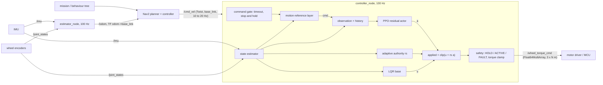

# ballbot_control: ROS 2 bridge for the ballbot controller

Software stack intended for running the study's recommended balance controller under ROS 2 and Nav2 on a future real robot (none exists yet, see below):
`g39_goalcentre_s0` (default), an LQR base + learned PPO residual with adaptive authority, trained on commands shaped by the
motion-reference layer, with all goal logic on the true ball centre (study log S118, S121). The earlier `g34_mref_rsad_db_s0`
(same recipe, goal logic on the ball body origin) is exported and installed as well.

There is no physical robot yet. Everything below was built and tested on a Windows machine **without ROS**: the control logic is a
pure-Python core (numpy only) that is tested with pytest against recorded simulator data; the ROS nodes are thin wrappers over it.
See [What was not verified](#what-was-not-verified).

## Architecture



ASCII version:

```
behaviour tree -> Nav2 (planner, controller) --/cmd_vel--> controller_node (100 Hz)
                                                            gate -> motion layer -> obs/history -> actor (a)
                                                            LQR (u), authority (rs) -> applied = clip(u + rs a)
                                                            safety -> /wheel_torque_cmd --> MCU / motor drivers
IMU (/imu) + encoders (/joint_states) --> estimator (attitude filter + gyro bias + Kalman) --> controller (internal copy)
                                                                                       \--> estimator_node: /odom, TF --> Nav2
```

The controller runs its own instance of the estimator on the same `/imu` and `/joint_states` messages (no transport delay inside
the balance loop); `estimator_node` runs the identical code for `/odom` and TF. Both see the same inputs and so agree.

## Layout

```
ros2/ballbot_control/                     ament_python package
  ballbot_control/core/                   pure Python, no ROS imports (enforced by a test)
    bundle.py        load bundle.json + actor weights
    state.py         RobotState: the measured quantities the controller consumes (with the simulator quantity each one reproduces)
    estimator.py     BallbotOdometry (port of experiments/warp_ppo/odometry.py) + StateEstimator (RobotState from IMU and encoders)
    motion_ref.py    motion-reference layer (port of experiments/warp_ppo/motion_ref.py) + training goal rule
    observation.py   25-D observation, 8-step history (newest first), design vector -> 255-D actor input
    policy.py        actor forward pass: numpy (default, no torch) or onnxruntime
    lqr.py           LQR base (port of experiments/warp_ppo/lqr_gpu.py GpuLQR.act)
    authority.py     adaptive residual authority (rs_adapt of train_dev.py)
    controller.py    TrackingController: one tick, torques out
    safety.py        SafetySupervisor (HOLD / ACTIVE / FAULT), CommandGate (timeout, stop and hold)
    runtime.py       ControlLoop: what controller_node does each tick, without ROS
  ballbot_control/nodes/controller_node.py, estimator_node.py
  launch/ballbot_control.launch.py
  config/ballbot_control.yaml             parameters
  config/bundle/g39_goalcentre_s0/        exported bundle (default): bundle.json, actor.onnx, actor.ts, actor_weights.npz
  config/bundle/g34_mref_rsad_db_s0/      exported bundle of the earlier run (goal point at the ball body origin)
  test/                                   pytest (runs without ROS), parity replay, closed-loop CPU MuJoCo check
experiments/warp_ppo/export_policy.py     checkpoint -> bundle (+ numerical verification)
experiments/warp_ppo/record_parity.py     records the simulator rollout the parity test replays (GPU, small)
```

## Message interfaces

| Node | Direction | Topic / service | Type | Notes |
|---|---|---|---|---|
| controller | sub | `/cmd_vel` | geometry_msgs/Twist | linear.x, linear.y (holonomic), angular.z; frame `base_link` (param `cmd_vel_frame`), rotated to odom with the estimated yaw; capped by `max_speed`, `max_yaw_rate` |
| controller | sub | `/goal_pose` (optional) | geometry_msgs/PoseStamped | odom-frame xy goal; trained arrival + position hold; a new `/cmd_vel` cancels it |
| controller, estimator | sub | `/imu` | sensor_msgs/Imu | `angular_velocity` rad/s and `linear_acceleration` (specific force, +9.81 z at rest) in `base_link`; orientation field unused (the core runs its own attitude filter) |
| controller, estimator | sub | `/joint_states` | sensor_msgs/JointState | joints `wheel_joint_0..2` (param `wheel_joints`), `velocity` rad/s about the joint axis; position-only messages are differentiated |
| controller | pub | `/wheel_torque_cmd` | std_msgs/Float64MultiArray | 3 torques, N m, joint order of `wheel_joints`, published every tick, zeros unless ACTIVE |
| controller | pub | `/ballbot/diagnostics` | diagnostic_msgs/DiagnosticArray | mode, reason, tilt, rs, cmd, tick-interval statistics |
| controller | pub | `/ballbot/debug` (optional) | std_msgs/Float64MultiArray | cmd(3), applied(3), lqr(3), residual(3), rs |
| controller | srv | `/ballbot/enable` | std_srvs/SetBool | true: request ACTIVE (granted only when tilt < `engage_tilt_deg` and the state is fresh); false: HOLD |
| controller | srv | `/ballbot/clear_fault` | std_srvs/Trigger | FAULT -> HOLD (then enable again) |
| estimator | pub | `/odom` | nav_msgs/Odometry | `odom` -> `base_link`, pose of the base_link origin, twist in base_link, covariance from the Kalman filter |
| estimator | tf | `odom -> base_link` | | param `publish_tf` |

Sign conventions are those of the MuJoCo model (`ballbot_gym/models/variants/dz_nom.xml`): wheel torque and encoder rate are about
each hinge axis as listed in `bundle.json` (`designs.table.nom.kinematics.wheel_axes_body`, base frame). The hardware driver must map
its motor directions to these axes; check with the robot on a stand before enabling (spin each wheel by hand and compare the sign of
the reported rate; command a small torque and compare the direction).

## Safety behaviour

* **Startup in HOLD**: zero torque until `/ballbot/enable` is called and the robot is upright (tilt < 3 deg) with fresh sensor data.
  Enabling resets the controller (a fresh episode, exactly how every training episode started).
* **Tilt cutoff**: tilt > `tilt_cutoff_deg` (30 deg) -> FAULT, zero torque, latched until `/ballbot/clear_fault` + enable.
* **Stale state**: no IMU and encoder data within `state_timeout` (50 ms) -> FAULT.
* **Non-finite torque or state** -> FAULT.
* **Torque clamp**: always to the design's actuator limit (30 N m for nom, as in training) and additionally to `torque_limit` if set.
  Note that a lower hardware limit than the trained one changes the closed loop; it was not studied.
* **Command timeout**: no `/cmd_vel` for `cmd_timeout` (0.5 s) -> desired velocity zero; with `hold_on_timeout` the robot holds
  position at its braking point (current position + v |v| / (2 a_brk)) using the trained goal-hold behaviour.
  Cutting torque is the only "safe" state for a ballbot that is not upright; a ballbot that is upright must keep balancing, so the
  timeout stops and holds rather than disabling.

## Export a new checkpoint

```bash
# 1. record a short simulator rollout for verification and the parity test (GPU, 33 worlds, about 2 min)
cd experiments/warp_ppo
../mjx_port/.venv/Scripts/python.exe record_parity.py --run <RUN> --n 3 --steps 600
# 2. export (actor files + bundle.json) and verify against the torch actor on the recorded observations
../mjx_port/.venv/Scripts/python.exe export_policy.py --run <RUN>
# 3. optional: verify the ONNX file with an interpreter that has onnxruntime
python export_policy.py --run <RUN> --verify-only
# 4. parity of the ROS core against the simulator, and a small test fixture (add <RUN> to RUNS in test/parity_replay.py to test it)
cd ../../ros2/ballbot_control/test
python parity_replay.py <RUN>
python parity_replay.py <RUN> --make-fixture
```

The full rollouts (`outputs/study/warp_ppo/*/parity_rollout.npz`, about 30 MB) are git-ignored; the tests use the fixtures in
`test/data/` and replay the full rollouts too when they are present.

The bundle (`bundle.json`) carries: control rate (100 Hz, action repeat 5 at 2 ms), observation layout (names, offsets, sizes,
units, clips, the motor-state quirk, reset observation), history length and ordering, actor input layout and dimensions,
normalisation (inside every model file), action combination and torque scaling, `rs_adapt` parameters, LQR weights and the
per-design discrete gains K with the wheel map W and ball radius (and how to recompute them), motion-layer and goal-rule
parameters, command limits, the design table (tau, Froude factor f, 6-D design vector; nom = zeros), estimator parameters and
encoder calibration, kinematic offsets, wheel axes, the goal point (`goal_point.goal_centre`, `goal_point.track_point`), the source
run and its args.json, and the export verification results.

### Goal point (`track_point`)

The goal rule, the goal observation entries and the motion layer's arrival and hold are measured at a point on the ball:
* `ball_centre` for runs trained with `--goal-centre` (g39 and later): the core uses the estimator's ball-centre position directly.
* `ball_body_origin` for older runs (g34): the simulator measured goals at the ball's body origin, 0.14 m from the centre, which
  circles the centre as the ball rolls; the core reproduces it by dead-reckoning the ball orientation from the encoders.

The bundle says which (`goal_point.track_point`); the controller node picks it up automatically (parameter `track_point` empty).
In both cases the adaptive-authority dead band reads the ball body-origin velocity in the simulator (unchanged by `--goal-centre`);
with `ball_centre` the core gives it the ball-centre velocity instead (see open issues).
Only proprioceptive checkpoints (`sdim = 0`) are supported; sensor (depth / scan) policies need an encoder input path that is not built.

## Running with Nav2

```bash
colcon build --packages-select ballbot_control && source install/setup.bash
ros2 launch ballbot_control ballbot_control.launch.py            # default bundle: the installed g39_goalcentre_s0
# the earlier controller:
ros2 launch ballbot_control ballbot_control.launch.py bundle:=$(ros2 pkg prefix ballbot_control)/share/ballbot_control/config/bundle/g34_mref_rsad_db_s0/bundle.json
ros2 service call /ballbot/enable std_srvs/srv/SetBool "{data: true}"
```

* Nav2's controller server publishes `/cmd_vel` at its own rate (typically 10 to 20 Hz) in `base_link`. The controller node keeps
  the latest command and runs the motion layer and the balance controller at 100 Hz; the motion layer turns the step changes into a
  slew- and turn-rate-limited reference the ballbot can follow. Keep `cmd_timeout` well above the Nav2 period (0.5 s default).
* The ballbot is holonomic: use a holonomic Nav2 controller (MPPI with the `Omni` motion model, or DWB with `max_vel_y` > 0) and
  set its velocity and acceleration limits at or below the motion layer's (speed <= `max_speed`, acceleration 0.4 m/s^2, braking
  0.5 m/s^2, lateral 0.35 m/s^2, yaw rate <= 1 rad/s). Faster planner limits are clipped by the motion layer anyway, which then
  makes the robot lag the planner's prediction.
* Footprint: a circle around the tower radius plus margin; the body leans into accelerations, so leave room above the base.
* `/odom` comes from IMU and encoders only; yaw and position drift. Use AMCL or SLAM for `map -> odom`.
* Nav2 `velocity_smoother` is optional (the motion layer already shapes commands); if used, set its limits as above.
* A behaviour-tree "stop" should send zero `/cmd_vel` (or let it time out): the robot brakes and holds; do not call disable while
  it is balancing unless someone is holding it.

## Real-time notes

* The policy was trained at exactly 100 Hz with the torque held for 10 ms. Run the tick on a timer at 100 Hz; jitter of a few ms
  is tolerable (training randomised a one-step actuation delay with probability 0.2 x 1.75), missed ticks are not modelled.
  `/ballbot/diagnostics` reports the maximum tick interval and the count of intervals over 15 ms.
* Executor: the node uses `rclpy.spin` (single-threaded executor), so sensor callbacks and the tick never run concurrently
  (no locks needed). Sensor subscriptions use best-effort, depth-1 QoS so only the newest sample is kept.
* Cost per tick (numpy, this PC): about 0.7 ms for the whole ControlLoop tick (estimator, motion layer, observation,
  255-512-512-512-3 MLP, LQR, safety). On an ARM SBC expect several ms; use `policy_backend: onnx` with onnxruntime if numpy is slow there.
* Python and the ROS 2 Python executor are not real-time. For a robot, prefer one of:
  1. run the node on an isolated core with `SCHED_FIFO` (`chrt -f 80`), a PREEMPT_RT kernel, and the DDS on loopback / shared memory;
  2. **ros2_control**: implement the core's tick (it is small: an MLP, a 4-state LQR, a few filters) in a C++ controller plugin
     (`controller_interface::ControllerInterface`) that reads the IMU and wheel state interfaces and writes three effort command
     interfaces at 100 Hz in the real-time loop, with the ONNX actor run by onnxruntime C++; this Python core and its parity tests
     then serve as the reference implementation and test oracle;
  3. run the whole balance loop on the MCU (the network is about 0.66 M multiply-adds per tick) and use ROS only for `/cmd_vel` and `/odom`.
* The IMU and encoder samples should be taken at the same instant, just before the tick; the filter assumes dt = 10 ms.

## Tests (no ROS needed)

```bash
cd ros2/ballbot_control
python -m pytest -q          # 37 tests, about 30 s
python test/parity_replay.py g39_goalcentre_s0     # parity report on the full recorded rollout (if present) or the fixture
python test/sim_closed_loop.py --speed 0.3   # closed loop on CPU MuJoCo with the estimator in the loop
```

| Test | What it checks |
|---|---|
| `test_parity.py` | core vs simulator on recorded g39 and g34 ticks (all 11 designs, velocity and goal episodes): shaped command, goal rule, 25-D observation, 255-D actor input, policy action, LQR action, authority, applied action, torque; history layout; design vectors; that the wrong goal point breaks parity |
| `test_policy_and_bundle.py` | numpy / ONNX / TorchScript actors vs recorded simulator actions; bundle dimensions; LQR gains recomputed from the planar model |
| `test_estimator.py` | estimator port equals the study's odometry.py; behaviour at rest; quaternion continuity; kinematic offsets vs the simulator; goal point taken from the bundle (centre for g39, body origin for g34) |
| `test_motion_and_safety.py` | motion layer equals the study's torch MotionRef (velocity, goal, hold, reversals); supervisor modes, faults, latch, clamp; command timeout and hold; LQR-only mode |
| `test_runtime.py` | ControlLoop startup, dropout fault, cmd_vel frame rotation and caps; closed-loop CPU MuJoCo run (balances, tracks 0.3 m/s, stops and holds on timeout) |
| `test_nodes_stubbed.py` | no ROS imports in the core; controller node wiring against stand-in rclpy and message classes |

### Parity results

Recorded with `record_parity.py` (33 worlds, 3 per design, 600 ticks, domain randomisation and pushes on, observation noise and
latency off, about half the episodes in goal mode). Max over ticks of the max abs difference core vs simulator, median after the
slash. The simulator runs float32 on the GPU, the core float64; the integrators accumulate rounding to about 1e-4 over 6 s.

| quantity | g39_goalcentre_s0 (13299 ticks) | g34_mref_rsad_db_s0 (14155 ticks) |
|---|---|---|
| shaped command | 5.2e-05 / 3.5e-07 | 6.4e-05 / 3.6e-07 |
| goal rule velocity | 1.4e-06 / 1.7e-07 | 2.1e-07 / 4.8e-08 |
| observation (25) | 1.1e-04 / 9.0e-07 | 1.1e-04 / 8.6e-07 |
| observation, goal-mode ticks only | 2.9e-05 / 1.8e-06 | 5.4e-05 / 1.5e-06 |
| actor input (255) | 1.1e-04 / 9.4e-07 | 1.1e-04 / 9.1e-07 |
| policy action | 1.1e-04 / 3.3e-07 | 5.4e-05 / 2.9e-07 |
| LQR action | 5.7e-05 / 3.8e-07 | 2.4e-04 / 3.4e-07 |
| residual authority rs | 5.1e-06 / 0 | 6.8e-05 / 0 |
| applied action | 5.6e-05 / 4.1e-07 | 2.4e-04 / 3.7e-07 |
| wheel torque (N m) | 1.3e-03 / 1.2e-05 | 1.5e-03 / 1.1e-05 |

Exported actor vs the torch actor (train_dev.Net) on 29700 recorded observations (parity and noisy phases):
g39: TorchScript 0, numpy weights (float64) 2.4e-07, ONNX via onnxruntime 7.2e-07, recorded GPU actions 3.0e-07;
g34: TorchScript 0, numpy 2.4e-07, ONNX 4.8e-07, recorded GPU actions 3.0e-07.

## What was not verified

* **No ROS build or run.** ROS 2 is not installed on this machine: `colcon build`, the launch file, real rclpy executors, QoS,
  TF, Nav2 integration and timing were never exercised. The nodes were only run against stand-in rclpy / message classes
  (`test_nodes_stubbed.py`), which checks wiring, not ROS behaviour. Expect small fixes on first build.
* **No hardware.** Motor sign conventions, encoder directions, IMU mounting and frame, torque constant / current mapping, motor
  driver latency, sensor noise and bias, ball and floor properties, real compute timing: all unverified.
* The parity test feeds the core the simulator's exact state. On the robot the state comes from the estimator. Two parts of that
  mapping are approximate:
  * the base angular velocity the policy saw in training is MuJoCo's `cvel`, 2 ms older than the gyro; using the gyro (as on hardware)
    changes the action by 1.8e-3 median, 2.7e-2 p99 (`parity_replay.py` reports it);
  * base-origin and base-COM velocities are reconstructed from the ball-centre velocity with rigid offsets; against the simulator
    this is 1 cm/s median but 0.3 m/s p99 (compliant wheel-ball contacts during pushes and impacts).
* The closed-loop check (`sim_closed_loop.py`) uses CPU MuJoCo, not the MuJoCo-Warp simulator the policy was trained in, with no
  noise, latency, arrestors or actuator model. With either bundle it balanced throughout and stopped and held after the command
  timeout (residual speed under 5 cm/s). Achieved speed over the cruise window for 0.3 / 0.6 m/s commands: g39 about 0.19 / 0.46,
  g34 about 0.25 / 0.56 m/s; odometry drift 8 to 16 cm over 1.1 to 3 m. The CPU plant differs from the training simulator, so these
  speeds are not a comparison of the two policies.
* The ONNX file was written by a small built-in writer because the `onnx` package is not installed; it loads and matches in
  onnxruntime 1.31.1, but was not checked by `onnx.checker` or other runtimes.

## Open issues

* **Goal point**: solved for g39 (goal logic on the ball centre, `track_point: ball_centre`). g34 still needs the ball body origin,
  which the core reproduces by dead-reckoning the ball orientation from the encoders.
* **Authority dead band**: in every run (g39 included) the simulator's adaptive-authority dead band compares the ball *body-origin*
  speed (qvel[9:11], which swings with the ball's rotation) with 0.05 m/s. In `ball_centre` mode the core uses the ball-centre
  speed, so on hardware the near-zero-command authority term can switch at different moments than in training. The parity test is
  exact because it feeds the simulator's value. Retraining with the dead band on the centre velocity (`--db-centre`, S122) removes the mismatch: g41 seed 0 matched g39 on every number in the study log, seeds 1 and 2 are retraining, and the exported bundle stays g39 until three seeds agree.
* **Motor-state observation quirk**: observation entries 9:12 are (base-origin y and z velocity, body x rate) / tau, an artefact of
  the training environment; the policy depends on them, so the core reproduces them from the estimator.
* The rotation-vector observation includes yaw and is not wrapped; the estimator keeps quaternion continuity like the simulator.
  Long runs with large yaw drift visit the |angle| > pi region less often seen in training.
* Encoder calibration C is the simulation least-squares fit of the nominal design; it must be re-fitted on the real robot
  (odometry.calibrate on a logged run with ground truth, e.g. motion capture).
* Torque limits lower than the trained 30 N m, a motor model, latency beyond one tick, and the real IMU noise were not studied.
* `package.xml` maintainer e-mail is a placeholder.
